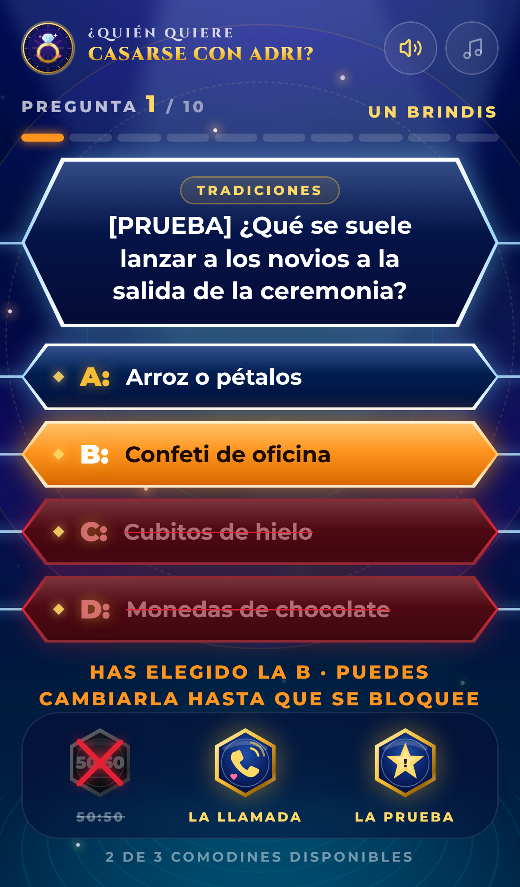
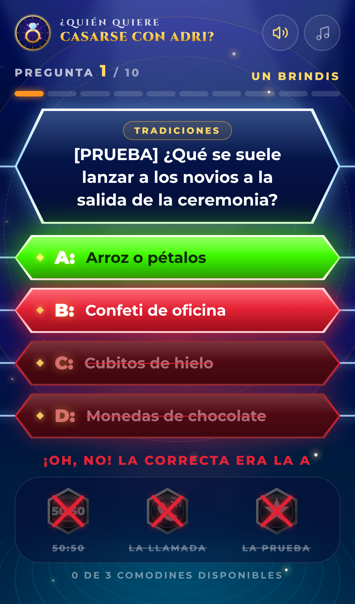
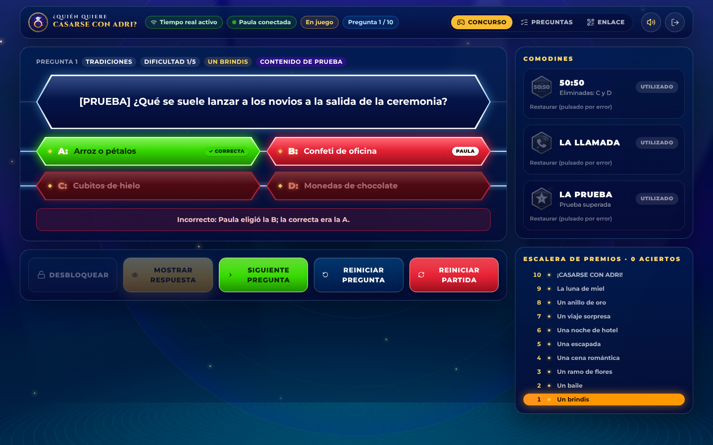

# ¿Quién quiere casarse con Adri?

Concurso televisivo interactivo para la despedida de soltera de Paula, con dos interfaces sincronizadas en tiempo real:

| Ruta | Para quién | Dispositivo |
| --- | --- | --- |
| `/presentador` | Quien dirige el concurso (privado, con login) | Ordenador o tablet |
| `/jugador?k=…` | Paula | Móvil (vertical) |

<p>
  
  
  
</p>


## Tecnología

- **React 19 + TypeScript + Vite** · **Tailwind CSS 4** · **Motion** (animaciones) · **Lucide** (iconos)
- **Supabase**: Postgres, Auth (presentador), Realtime (Broadcast + Presence)
- Efectos de sonido y música ambiente **generados en tiempo real con Web Audio API** (100 % originales, sin archivos con derechos)
- Fuentes autoalojadas (Montserrat y Cinzel vía `@fontsource`), sin dependencias externas en tiempo de ejecución salvo Supabase
- Despliegue en **Netlify**

## Cómo funciona la seguridad

La respuesta correcta **nunca sale del servidor** hacia el jugador antes de que el presentador pulse «Mostrar respuesta»:

- Las tablas `games`, `questions` y `game_state` tienen RLS activado y el rol `anon` no tiene **ningún** privilegio sobre ellas.
- El jugador solo puede llamar a tres funciones `SECURITY DEFINER` (`player_get_state`, `player_select_answer`, `player_use_lifeline`) que exigen la clave secreta de 128 bits del enlace y devuelven el estado **sin** la respuesta correcta (`correctAnswer` es `null` hasta la revelación).
- El presentador es un usuario de Supabase Auth; todas sus funciones (`host_*`) comprueban `games.host_id = auth.uid()`.
- Realtime solo transporta un número de versión (`realtime.send` desde un trigger). Cada cliente vuelve a pedir el estado por RPC, así que por la red del jugador tampoco viaja ningún secreto.
- Las acciones críticas bloquean la fila (`SELECT … FOR UPDATE`): son atómicas aunque Paula y el presentador pulsen a la vez.
- El 50:50 se calcula en el servidor: elimina 2 de las 3 incorrectas al azar.

## Sincronización y reconexión

`src/lib/useGameSync.ts` gestiona un único canal por partida (elimina canales duplicados), Presence (indicador «Paula conectada»), re-sincronización al reconectar, al volver a la pestaña o al recuperar la red, y un sondeo de respaldo (12 s con Realtime activo, 2,5 s si se cae). El estado vive en Postgres: recargar la página o perder la conexión no destruye la partida, y el presentador recupera el control al volver a entrar.

---

## 1. Instalar dependencias

```bash
npm install
```

## 2. Configurar Supabase

Ya existe un proyecto creado para el concurso: **`quien-quiere-casarse-con-adri`** (ref `hxxurkivutyfsivwedfk`, región París), con todas las tablas, funciones y políticas aplicadas.

Para usar otro proyecto, créalo en [supabase.com](https://supabase.com) y sigue los pasos 3 y 4.

**Recomendado** en *Authentication → URL Configuration*: pon como *Site URL* la URL de Netlify (por ejemplo `https://tu-sitio.netlify.app`) y añade `https://tu-sitio.netlify.app/presentador` a *Redirect URLs*, para que el enlace de confirmación del correo lleve al panel.

## 3. Crear las tablas

Abre *SQL Editor* en Supabase, pega el contenido de [`supabase/migrations/20261110190000_init.sql`](supabase/migrations/20261110190000_init.sql) y ejecútalo. Con la CLI de Supabase:

```bash
supabase link --project-ref TU_REF
```

```bash
supabase db push
```

## 4. Políticas RLS

Están incluidas en la misma migración (RLS, `revoke`/`grant` y funciones seguras). No hay que hacer nada más.

## 5. Variables de entorno

Copia `.env.example` a `.env.local` y rellena (Supabase → *Project Settings → API*):

```
VITE_SUPABASE_URL=https://TU-PROYECTO.supabase.co
VITE_SUPABASE_PUBLISHABLE_KEY=sb_publishable_...
```

Son claves **públicas** (publishable/anon), pensadas para el navegador; la seguridad la garantizan RLS y las funciones. **Nunca** uses la `service_role` key en el frontend. `.env.local` está en `.gitignore`. También se acepta `VITE_SUPABASE_ANON_KEY`.

## 6. Ejecutar en local

```bash
npm run dev
```

Abre `http://localhost:5173/presentador`, crea la cuenta del presentador (pulsa «¿Primera vez?») y confirma el correo. Al entrar se crea la partida con **10 preguntas de prueba marcadas como `[PRUEBA]`**. En la pestaña **Enlace** tienes el enlace y el QR para el móvil de Paula.

Pruebas automáticas del backend (necesitan un usuario presentador ya confirmado):

```bash
QA_EMAIL=presentador@ejemplo.com QA_PASSWORD=su-contraseña npm run qa
```

⚠️ Las pruebas juegan una partida completa y la reinician al final: no las lances durante el concurso.

## 7. Desplegar en Netlify

`netlify.toml` ya define todo: `npm run build`, carpeta `dist`, Node 22, redirecciones SPA para `/presentador` y `/jugador`, y cabeceras de seguridad (incluida `Referrer-Policy: no-referrer`, para que la clave del jugador no se filtre).

1. En Netlify: *Add new site → Import an existing project* → elige este repositorio de GitHub.
2. *Site configuration → Environment variables*: añade `VITE_SUPABASE_URL` y `VITE_SUPABASE_PUBLISHABLE_KEY`.
3. *Deploy*. Cada `git push` a `main` vuelve a desplegar.
4. Actualiza la *Site URL* de Supabase (paso 2) con la URL final.

---

## Guía rápida del concurso

1. **Antes de la fiesta**: en *Preguntas*, borra las de prueba («Borrar las de prueba») y añade las reales de Adri. Puedes editar, eliminar y reordenar (flechas). Cada pregunta tiene enunciado, 4 respuestas, correcta, categoría, dificultad (1–5) y premio.
2. Envía a Paula el enlace o enséñale el QR. Ella verá la pantalla de inicio y pulsará «Comenzar el concurso» (eso además activa el sonido en su móvil).
3. En *Concurso*, pulsa **Comenzar el concurso**.
4. Paula elige (naranja). Puede cambiar hasta que pulses **Bloquear respuesta** (opcional).
5. **Mostrar respuesta**: verde si acierta; si falla, su respuesta en rojo y la correcta en verde, con pausa dramática en su móvil.
6. **Siguiente pregunta** (en la última: **Ver resultado final**).
7. **Comodines** (una vez por partida, no se recuperan al cambiar de pregunta):
   - **50:50**: automático.
   - **La llamada**: pulsa *Iniciar 30 s* cuando conteste la persona y *Finalizar* al acabar.
   - **La prueba**: escribe o elige un reto, *Mostrar reto a Paula*, márcalo *Superada*/*No superada* y *Volver a la pregunta*.
   - Si Paula pulsa uno por error: *Restaurar (pulsado por error)*.
8. **Reiniciar pregunta** borra la respuesta de la pregunta actual (los comodines siguen gastados). **Reiniciar partida** vuelve todo al inicio. Ambas piden confirmación.
9. *Generar enlace nuevo* (pestaña Enlace) invalida el enlace anterior.

Sonido: el altavoz activa o silencia los efectos y la nota musical, la música ambiente. En móviles el audio se activa tras el primer toque en pantalla.

## Estructura

```
supabase/migrations/   Esquema, RLS y funciones (lógica del juego en el servidor)
src/lib/               Cliente Supabase, tipos, sincronización y sonido
src/components/        Logo, escenario, botones hexagonales, comodines, overlays, pantalla final
src/pages/             Inicio, Jugador, Presentador (login, panel, gestor de preguntas)
scripts/qa-backend.mjs Pruebas funcionales y de seguridad contra Supabase
netlify.toml           Build, redirecciones y cabeceras
```
